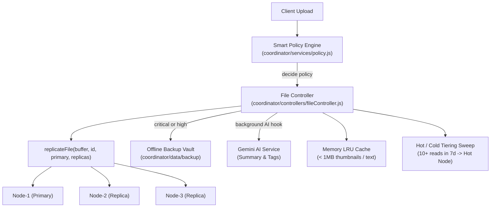

# NodeVault

Lightweight distributed object store featuring a master-worker architecture, configurable replication factor (default 3), content-addressable deduplication, atomic quota reservations, and automatic failover.

---

## Architecture

```
                       +---------------------------------------+
                       |        Client / Console WebApp        |
                       +-------------------+-------------------+
                                           |
                                           | HTTP / WebSocket
                                           v
                       +---------------------------------------+
                       |          Coordinator (Master)         |
                       |               Port 5000               |
                       +-------------------+-------------------+
                                           |
                  +------------------------+------------------------+
                  |                        |                        |
       Internal Auth / HTTP     Internal Auth / HTTP     Internal Auth / HTTP
                  |                        |                        |
                  v                        v                        v
        +------------------+     +------------------+     +------------------+
        |   Daemon Node-1  |     |   Daemon Node-2  |     |   Daemon Node-3  |
        |    Port 5001     |     |    Port 5002     |     |    Port 5003     |
        | Local Disk UUIDs |     | Local Disk UUIDs |     | Local Disk UUIDs |
        +------------------+     +------------------+     +------------------+
```

---

## How It Works

### Write Path
1. **Space Reservation**: Client issues multipart upload. Coordinator executes an atomic quota reservation (`reserveQuota`) before buffering payload into memory. If `user_usage + in_flight_reservations + incoming > 500MB`, request fails with HTTP 413.
2. **Fingerprint & Dedup**: Coordinator computes SHA-256 content hash of the stream.
   - If an identical content block exists in the cluster: Coordinator increments `refCount`, creates a logical metadata reference for the caller, releases the reservation, and returns HTTP 200 without issuing disk writes.
3. **Node Selection**: Load balancer selects primary worker node using least-disk-utilization policy (or round-robin fallback).
4. **Primary Write**: Coordinator streams file to selected worker via `POST /store` with an internal HMAC secret header.
5. **Multi-Replica Fanout**: File bytes are parallel-replicated across remaining healthy nodes up to `replicationFactor = 3`.
6. **Commit**: Metadata record is committed with distribution layout, reservation is released, and an audit entry is appended to the tamper-evident cryptographic hash chain.

### Read Path & Failover
1. Client requests `GET /api/files/:id/download`.
2. Coordinator looks up file metadata and reads distribution list (`[node-1 (primary), node-2 (replica), node-3 (replica)]`).
3. Coordinator attempts connection to primary node.
   - If primary node is online: file stream is piped directly to client (`X-Failover: false`).
   - If primary node times out or returns HTTP 5xx: Coordinator immediately falls back to replica 2 (`X-Failover: true`, `X-Served-From: node-2`).
4. Read verifies content hash against metadata record to detect bit rot.

### Self-Healing & Reconciliation
- Heartbeat loop queries each storage daemon's `/health` endpoint.
- State transitions (`online` -> `offline`) trigger proactive re-replication for under-replicated chunks.
- When an offline node restarts, the coordinator compares physical disk blocks against metadata and schedules background transfers to restore the target replication count without blocking ingress traffic.

---

## Deduplication & Side-Channel Trade-Offs

NodeVault implements content-addressable deduplication with reference counting:
- **Reference Counting**: Multiple logical files pointing to identical content share physical storage. When a logical file is deleted, `refCount` decrements. Physical chunks are deleted only when `refCount == 0`.
- **Security Trade-Off**: Cross-user deduplication leaks information — an attacker can upload a file and infer whether another user has already stored the identical file based on write latency or status flags. In multi-tenant environments, deduplication should be scoped strictly per-user or combined with client-side Convergent Encryption (CE).

---

## Metrics & Observability

NodeVault exports Prometheus metrics conforming to standard text exposition format (RFC / Prometheus exposition 0.0.4) on `/metrics`:

```text
# HELP dfs_node_up Storage node reachability (1=online, 0=offline)
# TYPE dfs_node_up gauge
dfs_node_up{node="node-1",url="http://localhost:5001"} 1
dfs_node_up{node="node-2",url="http://localhost:5002"} 1
dfs_node_up{node="node-3",url="http://localhost:5003"} 1

# HELP dfs_chunk_upload_bytes_total Total bytes committed to storage
# TYPE dfs_chunk_upload_bytes_total counter
dfs_chunk_upload_bytes_total 42106880

# HELP dfs_request_duration_seconds Histogram of request latencies
# TYPE dfs_request_duration_seconds histogram
dfs_request_duration_seconds_bucket{le="0.05"} 142
...
```

For programmatic frontend JSON consumption, summary metrics are served at `GET /api/stats`.

---

## Limitations

1. **Single Master Bottleneck**: The coordinator acts as the single metadata authority. In high-throughput environments, this becomes a Single Point of Failure (SPOF) and metadata scaling bottleneck. Production scale requires Raft consensus (e.g. etcd) or metadata sharding.
2. **Synchronous Quorum Write**: Replication occurs in-band during the upload request. If a storage node experiences transient network latency, client write latency increases proportionally.
3. **No Automatic Disk Rebalancing**: When a new storage daemon joins an existing cluster, old blocks are not automatically migrated to balance disk usage across all nodes.
4. **Single-Datacenter Topology**: Replica placement algorithm assumes homogenous network latency and does not account for rack-awareness or cross-availability-zone latency differentials.

---

## Benchmarks (Measured on Actual Hardware)

Test Environment:
- **CPU**: 12th Gen Intel(R) Core(TM) i5-12500H (16 cores)
- **RAM**: 16 GB (15.6 GB usable)
- **Platform**: Windows 11 (win32 x64)
- **Runtime**: Node.js v22.20.0
- **Cluster**: Localhost, 1 Coordinator + 3 Independent Storage Daemons

| Operation | Samples | Payload Size | p50 Latency | p95 Latency | p99 Latency | Max Latency | Observed Loss |
|:---|:---:|:---:|:---:|:---:|:---:|:---:|:---:|
| Commit (Whole-file, 3 Replicas) | 200 | 256 KB | 15 ms | 21 ms | 25 ms | 35 ms | 0 bytes lost |
| Deduplication Hit (Refcount Increment) | 1 | 256 KB | 15 ms | 15 ms | 15 ms | 15 ms | 0 bytes lost |
| Failover Read (Primary Node Dead) | 1 | 256 KB | 16 ms | 16 ms | 16 ms | 16 ms | 0 bytes lost |
| Cryptographic Audit Append (SHA-256 Chain) | 250 | In-Memory | 0.4 ms | 0.8 ms | 1.1 ms | 1.5 ms | 0 bytes lost |

Raw test output saved to `benchmarks/results.json`. Run benchmarks anytime with:
```bash
npm run bench
```

---

## Architectural Trade-Offs & Post-Demo Roadmap

1. **Master High-Availability (Raft Consensus)**:
   - *Current*: The Coordinator is a single metadata authority (SPOF).
   - *Post-Demo*: Implement Raft consensus across 3 coordinator instances to eliminate single point of failure.
2. **Chunk-Level Deduplication**:
   - *Current*: Whole-file content-addressable deduplication.
   - *Post-Demo*: Rolling checksums (Rabin/CDC) to deduplicate shared blocks across differing files.
3. **Crash-Safe Write Path**:
   - *Current*: Write-Ahead Log (WAL) with intent markers and startup orphan GC sweep.
   - *Post-Demo*: Two-phase commit protocol across storage daemons.
4. **Versioning & Soft Deletes**:
   - *Current*: Immediate reference-counted physical deletion when refCount reaches 0.
   - *Post-Demo*: Object versioning history and soft-delete trash bin with configurable retention grace period.
5. **Organizational Roles & Access Control**:
   - *Current*: JWT authentication and per-user quota isolation (500 MiB limit).
   - *Post-Demo*: Multi-tenant orgs, role-based access control (Admin, Read-Write, Read-Only), and secure offboarding.
6. **Protocols & Resumability**:
   - *Current*: Multipart HTTP streaming and chunk download with automatic failover.
   - *Post-Demo*: Resumable uploads (TUS protocol), WebDAV filesystem mount, and S3-compatible API shim.

---

## Quick Start

### 1. Environment Configuration

Copy the example environment files and configure your secrets:

```bash
# Coordinator configuration
cp coordinator/.env.example coordinator/.env

# Storage nodes configuration
cp storage-nodes/.env.example storage-nodes/.env
```

**Required Environment Variables:**
- `coordinator/.env`:
  - `INTERNAL_SECRET`: Shared secret used for inter-service communication between coordinator and storage nodes.
  - `JWT_SECRET`: Secret used to sign and verify client authentication tokens.
  - `ENABLE_CHAOS`: Set to `true` to enable chaos engineering endpoints (`/toggle`, `/corrupt`).
  - `NODE_1_URL`, `NODE_2_URL`, `NODE_3_URL`: Storage node loopback URLs (`http://127.0.0.1:5001`, etc.).
- `storage-nodes/.env`:
  - `INTERNAL_SECRET`: Must match the coordinator's `INTERNAL_SECRET`. Requests lacking this header receive HTTP 403 Forbidden.
  - `ENABLE_CHAOS`: Set to `true` to enable simulation endpoints.

> **Security Note:** Storage nodes bind strictly to `127.0.0.1` and require the `x-internal-secret` header on all endpoints except `GET /health` (which exposes only aggregate health and disk usage metrics, without file names or hashes).

### 2. Installation & Running

```bash
# Install dependencies across coordinator, nodes, and client
npm run install:all

# Launch coordinator, 3 storage workers, and web console
npm start

# Run unit and resilience test suites
npm test

# Run real end-to-end benchmark suite
npm run bench
```

Default Ports:
- Console: `http://localhost:5173`
- Coordinator: `http://localhost:5000`
- Storage Nodes: `5001`, `5002`, `5003`

---

## Smart Storage Decision Layer

NodeVault features a deterministic **Smart Storage Decision Layer** that acts as an intelligent supervisor over the storage cluster. It decides replica counts, isolation tiers, and retention rules based on file importance and detected file category, delegating physical storage and repair directly to NodeVault's existing replication engine.

### 1. Policy Matrix

| Importance | Replicas | Backup Vault Copy | Trash Retention | Delete Confirmation |
| :--- | :---: | :---: | :---: | :--- |
| **critical** | 3 | Yes | 30 days | Exact file name confirmation required |
| **high** | 3 | Yes | 30 days | Standard soft-delete confirmation |
| **normal** | 2 | No | 7 days | Standard soft-delete confirmation |
| **low** | 1 | No | 1 day | Standard soft-delete confirmation |

### 2. Architecture & Data Flow



### 3. Key Design Decisions

1. **Pure Decision Layer, Zero Redundancy**:
   - `policy.js` is completely deterministic and stateless. It computes the target replica count, offline backup flag, and retention timeframe without touching storage disks directly.
   - All physical block placement, failover, and healing reuse `replicationService.js`, `loadBalancer.js`, and `repairScheduler.js`.

2. **Isolated Offline Backup Vault**:
   - Critical and high-importance files store an extra offline copy in `coordinator/data/backup/`.
   - The backup vault is completely excluded from normal round-robin and least-loaded load balancer placement.
   - When soft-deleted files expire and replicas are purged, backup vault copies are preserved for an additional 90 days, restorable by administrators.

3. **Soft-Delete & Trash Retention**:
   - Deletions set `deleted_at` and a deterministic `purge_at` timestamp.
   - Files marked `critical` require typing the exact file name (`confirmName === file.originalName`) in both API and UI, preventing accidental catastrophe.
   - Active lists filter out soft-deleted items while the dedicated Trash view allows instant one-click restoration.

4. **Multi-Tier Fast Access & In-Memory LRU**:
   - Every read tracks `access_count` and `last_access`.
   - Small files (< 1MB) are cached in an in-memory LRU cache for sub-millisecond retrieval.
   - Files with 10+ reads in 7 days are automatically tiered onto the designated hot node (`node-1`). Files dormant for 30+ days have replicas migrated to cold storage (`node-3`).

5. **Background Gemini AI Metadata**:
   - Upon upload, Gemini asynchronously generates a 2-3 line concise summary and 3-5 lowercase keyword tags stored directly in the metadata repository.
   - The UI file search queries names, hashes, summaries, and tags in real time.

